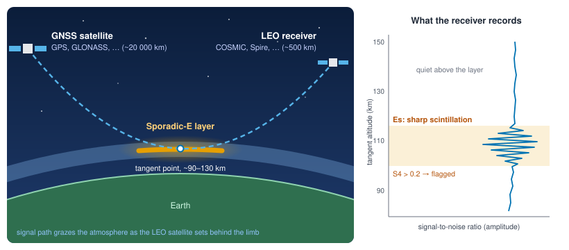
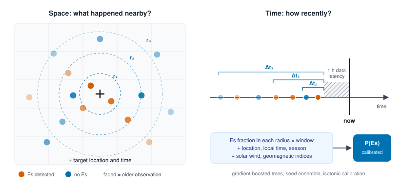
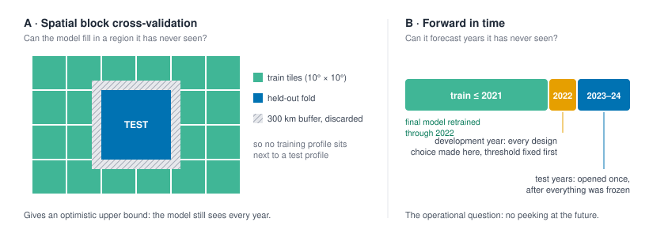
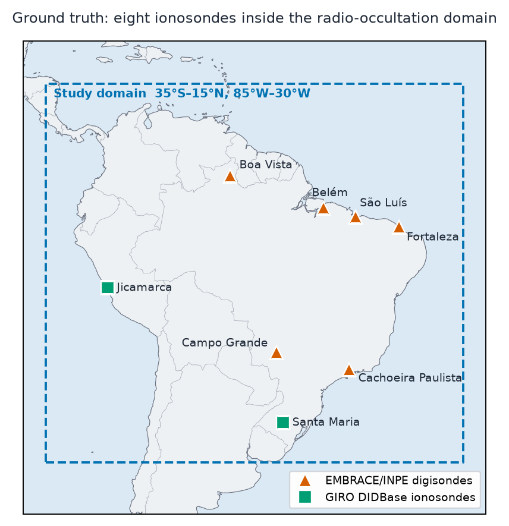
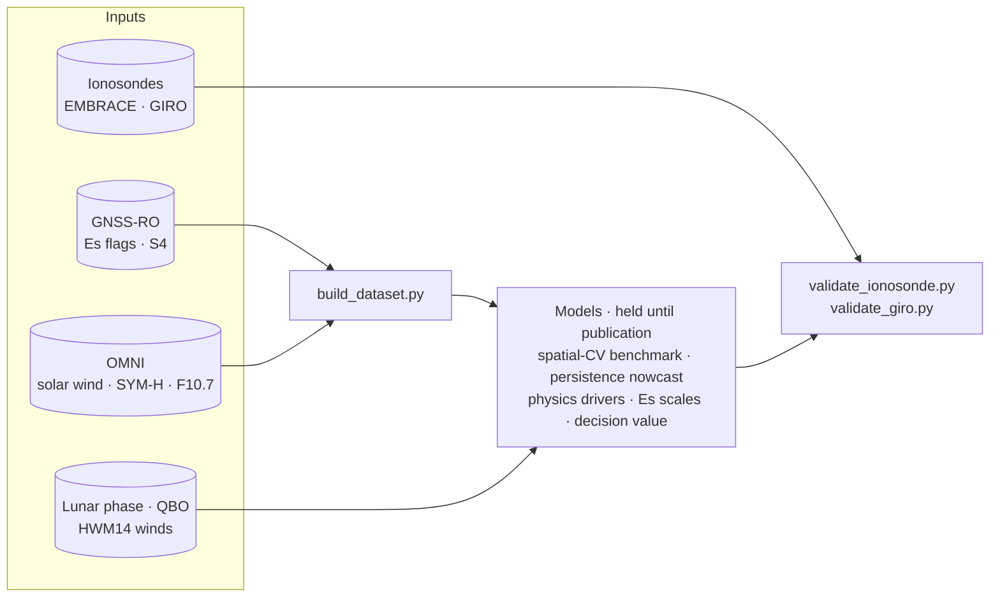

# Nowcasting Sporadic-E over South America

**Can we tell, an hour from now, whether a thin sheet of metal ions 100 km above South America will be disrupting radio signals?**

This repository holds the analysis code for a study that turns millions of GNSS radio-occultation soundings into calibrated, real-time probabilities of sporadic-E (Es) over South America, and checks them against ground ionosondes.

> **Status:** paper in preparation. The manuscript, results and processed dataset will be released here and on Zenodo at publication. Until then this repository contains the data pipeline, ground-validation and figure code only; the modelling code will be released with the paper.

---

## 1 · What is sporadic E?

Sporadic E is a thin, dense, patchy layer of metallic ions (Fe⁺, Mg⁺, Na⁺ ablated from meteors) that forms in the E region of the ionosphere at roughly **90–130 km**. Vertical shears in the neutral wind push the long-lived ions together into sheets only a few kilometres thick, and those sheets can carry more electrons than the normal E layer.

Why it matters:

| Effect | Who notices |
|---|---|
| Reflects VHF signals far beyond the horizon | FM/TV broadcast, aviation VHF radio |
| Opens and closes unexpected HF paths | HF communication, over-the-horizon radar |
| Scintillates GNSS signals that pass through it | GNSS positioning, radio occultation |

It is called *sporadic* for good reason. It appears and disappears within hours and is notoriously hard to predict.

## 2 · Seeing it from orbit

<p align="center"></p>

In **radio occultation (RO)**, a receiver on a low-Earth-orbit satellite (COSMIC, COSMIC-2, Spire, …) tracks a GNSS satellite as it sets behind the Earth's limb. The signal slices through the atmosphere layer by layer. When it grazes an Es layer, the signal amplitude flickers sharply at that altitude. A profile is flagged as Es when the **S4 scintillation index exceeds 0.2** at E-region heights.

Each profile is a pin-point observation at one place and one moment. Over South America that adds up to roughly a million soundings, scattered irregularly in space and time.

## 3 · The question

Most Es prediction work leans on **external drivers**: solar wind, geomagnetic activity, season, local time. This project asks a sharper question.

> *Which carries more predictive information, the space-weather drivers, or simply what the ionosphere was doing a few hours ago, nearby?*

To answer that fairly, we also test drivers that the physics says *should* matter:

- 🌙 **Lunar tide**: lunar local time, since the semidiurnal lunar tide modulates E-region wind shear
- 🌀 **Quasi-biennial oscillation (QBO)**: stratospheric winds that filter upward-propagating waves
- 💨 **Neutral winds from HWM14**: the Horizontal Wind Model, compiled from the Fortran source in [`hwm14/`](hwm14/), evaluated at every RO tangent point

## 4 · The persistence nowcast

<p align="center"></p>

For every target location and time, the model looks back at the **RO profiles already available**, under a realistic **1-hour data latency**. It summarises them as the fraction showing Es inside several radii and time windows. It adds location, local time, season and space-weather indices, and outputs a **calibrated probability** of Es.

From the same data we also measure how long Es patches last and how far they extend. We correlate climatology-removed labels between pairs of RO profiles as a function of their separation in time and in distance. That gives an e-folding **lifetime** and **length scale**, which together set the physical limit on how far persistence can reach.

## 5 · Testing it honestly

<p align="center"></p>

RO data are dense and autocorrelated, so a random train/test split would leak information and flatter the model. We use two stricter designs.

- **A · Spatial block CV**: 10° tiles, with a 300 km buffer between training and test profiles. This answers whether the model can map Es where it has no data.
- **B · Forward in time**: all design choices are tuned on 2022 against a pre-declared threshold. The 2023–2024 test years are opened **once**, after the model is frozen. This is the operational setting.

We also turn skill into **decision value** with the cost-loss framework (Richardson, 2000). For a user who pays *C* to protect against an Es event that would otherwise cost *L*, the question is how much the forecast is worth at each ratio *α = C/L*.

## 6 · Checking against the ground

<p align="center"></p>

Satellite labels are not ground truth, so every model is also scored against **eight independent ionosondes**:
- **six EMBRACE/INPE digisondes**, with Es scaled from raw SAO files (`foEs`, `fbEs`, Es type)
- **two GIRO DIDBase stations**, Santa Maria and Jicamarca

Where EMBRACE and GIRO overlap, their Es flags are cross-checked against each other.

## 7 · Pipeline



## 8 · Running it

```bash
python -m venv .venv && source .venv/bin/activate
pip install -r requirements.txt
```

The scripts expect the processed dataset `combined_data.csv.gz` in the repository root. It is released with the paper, so until then please contact the authors. The ionosonde downloaders (`download_ionosonde.py`, `download_giro.py`) fetch public data directly.

<details>
<summary>Script guide</summary>

| Stage | Scripts |
|---|---|
| Data | `build_dataset.py`, `download_ionosonde.py`, `download_giro.py`, `parse_sao.py`, `hwm_features.py` |
| Modelling | *released with the paper* |
| Ground validation | `validate_ionosonde.py`, `iono_robustness.py`, `iono_persistence_check.py`, `validate_giro.py` |
| Figures | `paper_style.py`, `make_*.py` |

HWM14 is built from Fortran (`gfortran -c hwm14/hwm14.f90 hwm14/driver.f90`, then link). See `hwm_features.py` for details.
</details>

## Data and acknowledgements

- **Radio occultation:** UCAR COSMIC Data Analysis and Archive Center, <https://data.cosmic.ucar.edu/gnss-ro/>
- **Solar wind and indices:** NASA OMNIWeb
- **Ionosondes:** EMBRACE/INPE, and GIRO DIDBase via the Lowell GIRO Data Center (data providers credited per station)
- **QBO:** NOAA PSL
- **HWM14:** Drob et al. (2015), Earth and Space Science

## Citation

A citation will be added when the paper is published.
